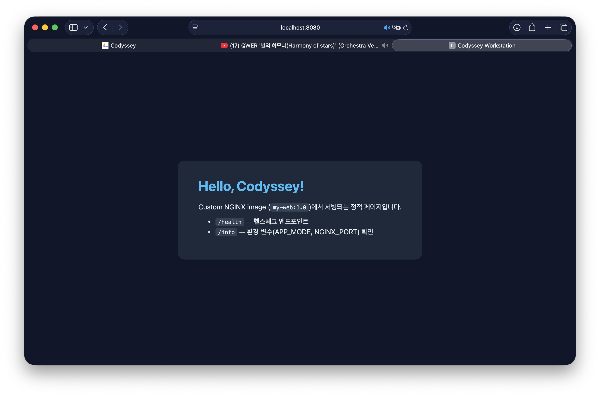
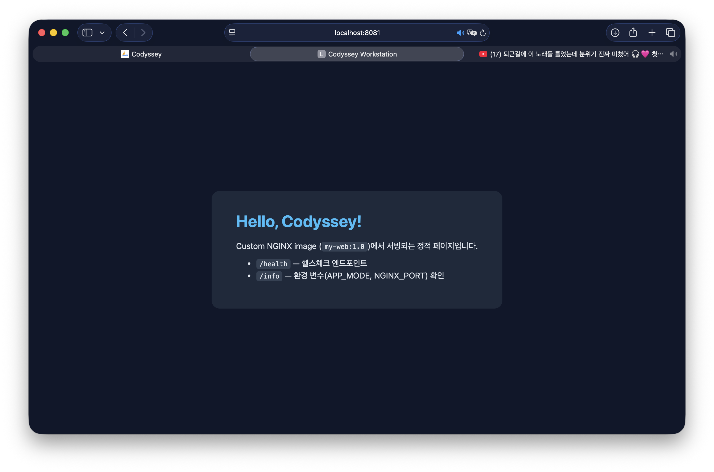
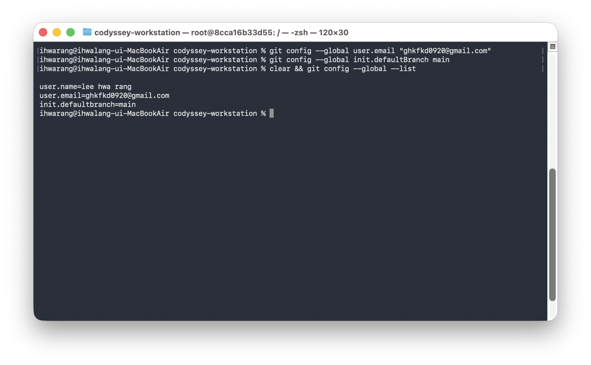
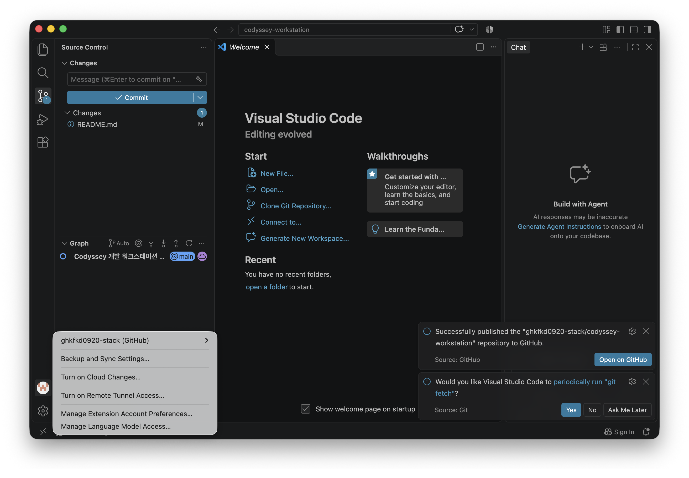

# 🛠️ Codyssey 개발 워크스테이션 구축

> 터미널 · Docker(OrbStack) · Git/GitHub 를 직접 세팅하고, **실행 결과(로그/접속/데이터 유지)** 로 검증한 기록입니다.
> 모든 명령과 출력은 `scripts/` 의 스크립트로 재현할 수 있으며, 원본 로그는 [`logs/`](logs/) 에 있습니다.

---

## 목차
1. [프로젝트 개요](#1-프로젝트-개요)
2. [실행 환경](#2-실행-환경)
3. [저장소 구조](#3-저장소-구조)
4. [재현 방법 (평가자용)](#4-재현-방법-평가자용)
5. [수행 체크리스트](#5-수행-체크리스트)
6. [수행 내용과 검증](#6-수행-내용과-검증)
7. [개념 정리](#7-개념-정리)
8. [트러블슈팅](#8-트러블슈팅)
9. [보안 및 개인정보 보호](#9-보안-및-개인정보-보호)
10. [보너스 과제](#10-보너스-과제)

---

## 1. 프로젝트 개요

| 목표 | 이 저장소에서 확인하는 방법 |
|---|---|
| 터미널로 디렉토리·파일·권한 다루기 | `scripts/01_terminal.sh`, `02_permissions.sh` |
| Docker 설치/점검 및 컨테이너 운영 | `scripts/03_docker_basic.sh` |
| 기존 이미지 기반 커스텀 이미지 제작 | [`Dockerfile`](Dockerfile) (nginx:alpine + 정적 사이트/설정/헬스체크) |
| 포트 매핑으로 외부 접속 | 같은 이미지를 8080, 8081 두 포트로 실행 |
| 바인드 마운트 / 볼륨 | 호스트 변경 즉시 반영, 컨테이너 삭제 후에도 데이터 유지 |
| Git/GitHub 협업 기반 | Git 설정 + VSCode GitHub 연동 |

핵심 원칙: **이미지(불변 설계도)와 컨테이너(실행 인스턴스)를 분리**하고, 포트·스토리지를 명시적으로 연결하여 *누가 몇 번 실행해도 같은 결과가 나오는 환경*을 만든다.

---

## 2. 실행 환경

| 항목 | 값 | 확인 명령 |
|---|---|---|
| OS | `macOS 26.3.1 (Build 25D2128, Apple Silicon arm64)` | `sw_vers` |
| Shell | `zsh` (macOS 기본) | `echo $SHELL && $SHELL --version` |
| Terminal | macOS 기본 터미널(Terminal.app) | – |
| Container Runtime | OrbStack `<버전>` | OrbStack 앱 → About |
| Docker | `Docker version 29.8.2, build 7fc2dff` (Server 29.8.2, OS: OrbStack) | `docker --version` |
| Git | `git version 2.50.1 (Apple Git-155)` | `git --version` |

> **서울캠퍼스 환경 주의**: `sudo` 사용이 제한되어 Docker Engine 을 직접 설치하지 않고 **OrbStack** 을 사용했다.
> OrbStack 앱을 실행하면 내부 Docker 엔진이 함께 구동되며, 터미널에서는 일반 `docker` 명령을 그대로 쓴다.
> Linux 등 다른 환경에서는 Docker Engine/Docker Desktop 으로 대체 가능하며 스크립트는 동일하게 동작한다.

---

## 3. 저장소 구조

```text
.
├── README.md                     # 기술 문서 (이 파일)
├── Dockerfile                    # 커스텀 이미지 정의 (nginx:alpine 기반)
├── docker-compose.yml            # 보너스: web + whoami 멀티 컨테이너
├── .env.example                  # 보너스: Compose 환경 변수 예시
├── app/
│   ├── site/index.html           # 정적 웹 페이지 (웹 서버 소스)
│   └── nginx/default.conf.template  # nginx 설정 템플릿 (/health, /info)
├── scripts/                      # 실습 자동화 + 로그 기록 스크립트
│   ├── lib.sh                    #   "$ 명령" + 출력 을 logs/ 에 기록, 민감정보 마스킹
│   ├── 01_terminal.sh ~ 08_compose.sh
│   └── run_all.sh
├── logs/                         # 스크립트 실행 결과 (명령 + 출력 원본)
├── mount-demo/                   # 바인드 마운트 실습용 호스트 디렉토리
└── docs/screenshots/             # 브라우저 / GitHub 연동 캡처
```

---

## 4. 재현 방법 (평가자용)

```bash
# 0) OrbStack(또는 Docker) 실행 후 데몬 확인
docker info > /dev/null && echo "docker OK"

# 1) 저장소 받기
git clone <이 저장소 URL>
cd <저장소 폴더>

# 2) 전체 실습 실행 → logs/*.log 생성
bash scripts/run_all.sh

# 3) 브라우저 확인
open http://localhost:8080   # macOS (Linux: xdg-open)
open http://localhost:8081

# 4) 보너스
bash scripts/08_compose.sh

# 5) 정리
docker rm -f my-web-8080 my-web-8081 my-web-prod
docker volume rm mydata
```

**PC 종속 사항 / 대체 방법**
- 경로는 모두 스크립트가 `$ROOT`(저장소 루트) 기준으로 계산하므로 어떤 위치에 clone 해도 된다.
- 8080~8083, 8090~8091 포트를 사용한다. 이미 사용 중이면 스크립트의 `-p` 앞쪽(호스트 포트) 숫자만 바꾼다.
- Apple Silicon/Intel 모두 공식 멀티아키텍처 이미지(`nginx:alpine`, `ubuntu:22.04`)를 사용하므로 차이가 없다.

---

## 5. 수행 체크리스트

- [x] 터미널 기본 조작 및 폴더 구성 → [6-1](#6-1-터미널-기본-조작)
- [x] 권한 변경 실습 (파일 1, 디렉토리 1) → [6-2](#6-2-권한-실습)
- [x] Docker 설치/점검 (`--version`, `info`) → [6-3](#6-3-docker-설치-및-점검)
- [x] Docker 기본 운영 (images / ps / logs / stats) → [6-4](#6-4-docker-기본-운영-명령)
- [x] hello-world, ubuntu 컨테이너 실행 + attach/exec 비교 → [6-5](#6-5-컨테이너-실행-실습)
- [x] Dockerfile 커스텀 이미지 빌드/실행 → [6-6](#6-6-커스텀-이미지-제작)
- [x] 포트 매핑 접속 (2회: 8080, 8081) → [6-7](#6-7-포트-매핑-및-접속)
- [x] 바인드 마운트 반영 → [6-8](#6-8-바인드-마운트)
- [x] 볼륨 영속성 → [6-9](#6-9-docker-볼륨-영속성)
- [x] Git 설정 + VSCode GitHub 연동 → [6-10](#6-10-git-설정-및-github-연동)
- [x] 트러블슈팅 5건 → [8](#8-트러블슈팅)
- [x] 보너스: Compose 단일/멀티, 운영 명령, 환경 변수 → [10](#10-보너스-과제)

### 검증 요약표

| 항목 | 검증 명령 | 성공 기준 | 증거 |
|---|---|---|---|
| 터미널 | `pwd`, `ls -la`, `cp`, `mv`, `rm` | 생성/복사/이동/삭제 결과가 목록에 반영 | [logs/01_terminal.log](logs/01_terminal.log) |
| 권한 | `chmod 644/755/700`, `ls -l(d)` | 변경 전후 권한 문자열이 다르고 실행 가능 여부가 바뀜 | [logs/02_permissions.log](logs/02_permissions.log) |
| Docker 점검 | `docker --version`, `docker info` | 버전 출력, Server Version 표시 | [logs/03_docker_basic.log](logs/03_docker_basic.log) |
| 운영 명령 | `docker images/ps -a/logs/stats` | 이미지·컨테이너 목록, 로그, 리소스 출력 | [logs/03_docker_basic.log](logs/03_docker_basic.log) |
| 커스텀 이미지 | `docker build`, `docker inspect` | 빌드 성공, Label/Env 확인 | [logs/04_build_run.log](logs/04_build_run.log) |
| 포트 매핑 | `curl localhost:8080`, `:8081` | `<h1>Hello, Codyssey!</h1>` 응답 | [logs/04_build_run.log](logs/04_build_run.log), [캡처](docs/screenshots/) |
| 바인드 마운트 | 호스트 수정 전/후 `curl :8083` | BEFORE → AFTER 로 응답 변경 | [logs/05_bind_mount.log](logs/05_bind_mount.log) |
| 볼륨 | 컨테이너 삭제 후 새 컨테이너에서 `cat` | 같은 내용 출력 | [logs/06_volume.log](logs/06_volume.log) |
| Git | `git config --list` | user.name/email, init.defaultBranch=main | [logs/07_git.log](logs/07_git.log), [캡처](docs/screenshots/) |

---

## 6. 수행 내용과 검증

### 6-1. 터미널 기본 조작
실행: `bash scripts/01_terminal.sh` · 전체 로그: [logs/01_terminal.log](logs/01_terminal.log)

| 작업 | 명령 |
|---|---|
| 현재 위치 / 목록(숨김 포함) | `pwd`, `ls -la` |
| 이동 / 생성 | `cd`, `mkdir -p practice/docs` |
| 빈 파일 / 내용 확인 | `touch empty.txt`, `cat memo.txt` |
| 복사 / 이동·이름변경 / 삭제 | `cp`, `mv`, `rm`, `rm -r` |

```bash
$ pwd
/Users/ihwarang/Desktop/codyssey-workstation

$ ls -la
drwxr-xr-x@ 14 ihwarang  staff    448 11월  5 17:22 .
-rw-------@  1 ihwarang  staff    139 11월  5 17:02 .env.example      # 숨김 파일(.)도 표시됨
drwxr-xr-x   9 ihwarang  staff    288 11월  5 17:22 .git
-rw-------@  1 ihwarang  staff     59 11월  5 17:02 .gitignore
drwxr-xr-x@  5 ihwarang  staff    160 11월  3 17:29 app
-rw-------@  1 ihwarang  staff   1153 11월  5 17:02 Dockerfile
...

$ mkdir -p practice/docs
$ cd practice && pwd                                              # 상대 경로 이동
/Users/ihwarang/Desktop/codyssey-workstation/practice
$ cd "/Users/ihwarang/Desktop/codyssey-workstation/practice" && pwd  # 절대 경로 이동
/Users/ihwarang/Desktop/codyssey-workstation/practice

$ touch empty.txt && ls -l empty.txt                              # 빈 파일 (크기 0)
-rw-r--r--  1 ihwarang  staff  0 11월  5 17:22 empty.txt
$ echo "hello codyssey" > memo.txt && cat memo.txt
hello codyssey

$ cp memo.txt docs/memo_copy.txt                                  # 복사
$ mv empty.txt renamed.txt && mv renamed.txt docs/                # 이름 변경 + 이동
$ ls -la docs
-rw-r--r--  1 ihwarang  staff   15 11월  5 17:22 memo_copy.txt
-rw-r--r--  1 ihwarang  staff    0 11월  5 17:22 renamed.txt

$ rm docs/renamed.txt && rm -r docs                               # 삭제
$ ls -la
-rw-r--r--   1 ihwarang  staff   15 11월  5 17:22 memo.txt
```

### 6-2. 권한 실습
실행: `bash scripts/02_permissions.sh` · 전체 로그: [logs/02_permissions.log](logs/02_permissions.log)

| 대상 | 변경 전 | 변경 후 | 관찰 |
|---|---|---|---|
| 파일 `hello.sh` | `644 -rw-r--r--` | `755 -rwxr-xr-x` | 644 에서는 `Permission denied`, 755 에서는 실행됨 |
| 디렉토리 `secret_dir` | `755 drwxr-xr-x` | `700 drwx------` | 소유자 외 접근 차단 |
| 디렉토리 `secret_dir` | `700` | `300 d-wx------` | `ls` 불가(r 없음), 파일명을 알면 `cat` 가능(x 있음) |

```bash
# [파일] 644 → 755
$ chmod 644 hello.sh && ls -l hello.sh
-rw-r--r--  1 ihwarang  staff  31 11월  5 17:22 hello.sh
$ ./hello.sh
./lib.sh: line 18: ./hello.sh: Permission denied
$ chmod 755 hello.sh && ls -l hello.sh
-rwxr-xr-x  1 ihwarang  staff  31 11월  5 17:22 hello.sh
$ ./hello.sh
script executed
$ chmod u=rwx,go=r hello.sh && ls -l hello.sh      # 기호 표기 (= 744)
-rwxr--r--  1 ihwarang  staff  31 11월  5 17:22 hello.sh

# [디렉토리] 755 → 700 → 300
$ chmod 755 secret_dir && ls -ld secret_dir
drwxr-xr-x  3 ihwarang  staff  96 11월  5 17:22 secret_dir
$ chmod 700 secret_dir && ls -ld secret_dir
drwx------  3 ihwarang  staff  96 11월  5 17:22 secret_dir
$ chmod 300 secret_dir && ls -ld secret_dir
d-wx------  3 ihwarang  staff  96 11월  5 17:22 secret_dir
$ ls secret_dir
ls: secret_dir: Permission denied        # r 없음 → 목록 불가
$ cat secret_dir/a.txt
data                                     # x 있음 → 이름을 알면 접근 가능
```

### 6-3. Docker 설치 및 점검
```bash
$ docker --version
Docker version 29.8.2, build 7fc2dff

$ docker info --format "Server Version: {{.ServerVersion}} | OS: {{.OperatingSystem}} | CPUs: {{.NCPU}} | Mem: {{.MemTotal}} | Containers: {{.Containers}}"
Server Version: 29.8.2 | OS: OrbStack | CPUs: 8 | Mem: 4179832832 | Containers: 0

$ docker context ls
NAME         DESCRIPTION                               DOCKER ENDPOINT
default      Current DOCKER_HOST based configuration   unix:///var/run/docker.sock
orbstack *   OrbStack                                  unix:///Users/ihwarang/.orbstack/run/docker.sock
```
→ `Server Version` 이 출력되므로 데몬(OrbStack 내부 엔진)이 동작 중이며, 현재 컨텍스트는 `orbstack` 이다.

### 6-4. Docker 기본 운영 명령
| 분류 | 명령 |
|---|---|
| 이미지 | `docker pull`, `docker images` |
| 컨테이너 | `docker run`, `docker stop`, `docker ps`, `docker ps -a`, `docker rm` |
| 운영 | `docker logs`, `docker stats --no-stream` |

```bash
$ docker pull hello-world
Status: Downloaded newer image for hello-world:latest
$ docker pull ubuntu:22.04
Status: Downloaded newer image for ubuntu:22.04

$ docker images
IMAGE                ID             DISK USAGE   CONTENT SIZE
hello-world:latest   c567b231f656       18.5kB         10.3kB
ubuntu:22.04         076e7bf82319        107MB         29.7MB

$ docker run -d --name ubuntu-keep ubuntu:22.04 sleep infinity
$ docker ps
CONTAINER ID   IMAGE          COMMAND            STATUS                  NAMES
5ac1fc3ab877   ubuntu:22.04   "sleep infinity"   Up Less than a second   ubuntu-keep

$ docker logs hello | head -5
Hello from Docker!
This message shows that your installation appears to be working correctly.

$ docker stats --no-stream
CONTAINER ID   NAME          CPU %     MEM USAGE / LIMIT   MEM %     PIDS
5ac1fc3ab877   ubuntu-keep   0.00%     940KiB / 3.893GiB   0.02%     1

$ docker stop ubuntu-keep
$ docker ps -a
CONTAINER ID   IMAGE          COMMAND            STATUS                                NAMES
5ac1fc3ab877   ubuntu:22.04   "sleep infinity"   Exited (137) Less than a second ago   ubuntu-keep
840b5e53b432   hello-world    "/hello"           Exited (0) 12 seconds ago             hello
```
→ `docker ps` 는 실행 중인 것만, `docker ps -a` 는 종료된 컨테이너까지 보여준다.

### 6-5. 컨테이너 실행 실습

**hello-world**
```bash
$ docker run --name hello hello-world

Hello from Docker!
This message shows that your installation appears to be working correctly.
...
 2. The Docker daemon pulled the "hello-world" image from the Docker Hub.
    (arm64v8)
...
```

**ubuntu 일회성 실행 / 백그라운드 + exec**
```bash
$ docker run --rm ubuntu:22.04 bash -c "ls / && echo hello from ubuntu && cat /etc/os-release | head -2"
bin  boot  dev  etc  home  lib  media  mnt  opt  proc  root  run  sbin  srv  sys  tmp  usr  var
hello from ubuntu
PRETTY_NAME="Ubuntu 22.04.5 LTS"

$ docker exec ubuntu-keep bash -c "echo inside container && ls /home && hostname"
inside container
5ac1fc3ab877            # hostname = 컨테이너 ID → 격리된 환경임을 확인
```

**ubuntu 내부 진입 (대화형, 직접 실행)**
```bash
$ docker run -it --name u1 ubuntu:22.04 bash
root@8cca16b33d55:/# ls
bin  boot  dev  etc  home  lib  media  mnt  opt  proc  root  run  sbin  srv  sys  tmp  usr  var
root@8cca16b33d55:/# echo "hello inside ubuntu"
hello inside ubuntu
root@8cca16b33d55:/# exit
exit

$ docker ps -a --filter name=u1
CONTAINER ID   IMAGE          COMMAND   CREATED          STATUS                     NAMES
8cca16b33d55   ubuntu:22.04   "bash"    30 seconds ago   Exited (0) 9 seconds ago   u1
```
→ 프롬프트가 `root@<컨테이너ID>:/#` 로 바뀌어 컨테이너 내부(ubuntu)에 진입했음을 확인. `exit` 후 컨테이너는 `Exited`.

**attach vs exec 관찰**
```bash
# attach: 메인 프로세스(bash)에 붙음 → exit 하면 컨테이너 종료
$ docker start u1
u1
$ docker attach u1
root@8cca16b33d55:/# exit
exit
$ docker ps -a --filter name=u1
CONTAINER ID   IMAGE          COMMAND   CREATED          STATUS                     NAMES
8cca16b33d55   ubuntu:22.04   "bash"    59 seconds ago   Exited (0) 5 seconds ago   u1

# exec: 새 bash 프로세스를 추가 실행 → exit 해도 컨테이너 유지
$ docker start u1
u1
$ docker exec -it u1 bash
root@8cca16b33d55:/# exit
exit
$ docker ps --filter name=u1
CONTAINER ID   IMAGE          COMMAND   CREATED              STATUS          NAMES
8cca16b33d55   ubuntu:22.04   "bash"    About a minute ago   Up 20 seconds   u1

$ docker rm -f u1
u1
```

| 방식 | 붙는 대상 | `exit` 시 컨테이너 |
|---|---|---|
| `docker run -it ... bash` | 메인 프로세스(PID 1) = bash | **종료** (PID 1 이 끝나서) |
| `docker attach` | 이미 실행 중인 메인 프로세스의 입출력 | **종료** (PID 1 에서 exit) · 종료 없이 빠지려면 `Ctrl+P, Ctrl+Q` |
| `docker exec -it ... bash` | 새 프로세스를 추가로 실행 | **유지** (추가 프로세스만 끝남) |

> 결론: 컨테이너의 수명은 **메인 프로세스(PID 1)** 의 수명과 같다. 디버깅용 접속은 `exec` 가 안전하다.

### 6-6. 커스텀 이미지 제작
선택 방식: **(A) 웹 서버 베이스 이미지 활용** — 공식 `nginx:alpine` 이미지 위에 정적 콘텐츠/설정만 교체

| # | 커스텀 포인트 | 목적 |
|---|---|---|
| 1 | `LABEL` | 이미지 제목/설명 메타데이터 → `docker inspect` 로 출처 확인 |
| 2 | `ENV NGINX_PORT=80 APP_MODE=dev` | 실행 시 `-e` 로 포트·모드를 바꿀 수 있도록 설정을 코드에서 분리 |
| 3 | 기본 `default.conf` 제거 → 템플릿 설정 복사 | `/health`, `/info` 엔드포인트 추가, 포트를 환경 변수로 결정 |
| 4 | `COPY app/site/` | 기본 환영 페이지 대신 직접 만든 페이지 배포 |
| 5 | `HEALTHCHECK` | 컨테이너가 "실행 중"이 아니라 "정상 응답 중"인지 Docker 가 판단 (`(healthy)`) |

```bash
$ docker build -t my-web:1.0 .
#0 building with "orbstack" instance using docker driver
...
$ docker images my-web
IMAGE        ID             DISK USAGE   CONTENT SIZE
my-web:1.0   cd93595b93cc       94.4MB         26.3MB

$ docker inspect my-web:1.0 --format "Labels={{json .Config.Labels}} Env={{json .Config.Env}}"
Labels={..."org.opencontainers.image.description":"Codyssey workstation mission - custom nginx","org.opencontainers.image.title":"my-custom-nginx"}
Env=[..."NGINX_VERSION=1.31.8",...,"NGINX_PORT=80","APP_MODE=dev"]
```
→ 직접 추가한 LABEL 과 ENV 가 이미지에 반영되었다.

### 6-7. 포트 매핑 및 접속
```bash
$ docker run -d -p 8080:80 --name my-web-8080 my-web:1.0
$ curl -s http://localhost:8080 | grep -o "<h1>.*</h1>"
<h1>Hello, Codyssey!</h1>
$ curl -s http://localhost:8080/health
ok

$ docker run -d -p 8081:80 --name my-web-8081 my-web:1.0
$ curl -s http://localhost:8081 | grep -o "<h1>.*</h1>"
<h1>Hello, Codyssey!</h1>

$ docker ps --format "table {{.Names}}\t{{.Image}}\t{{.Ports}}\t{{.Status}}"
NAMES         IMAGE        PORTS                                                 STATUS
my-web-prod   my-web:1.0   80/tcp, 0.0.0.0:8082->8000/tcp, [::]:8082->8000/tcp   Up 10 seconds (healthy)
my-web-8081   my-web:1.0   0.0.0.0:8081->80/tcp, [::]:8081->80/tcp               Up 12 seconds (healthy)
my-web-8080   my-web:1.0   0.0.0.0:8080->80/tcp, [::]:8080->80/tcp               Up 15 seconds (healthy)

$ docker logs --tail 3 my-web-8080
192.168.215.1 - - [05/Nov/2026:08:31:26 +0000] "GET / HTTP/1.1" 200 991 "-" "curl/8.7.1" "-"
127.0.0.1 - - [05/Nov/2026:08:31:29 +0000] "GET /health HTTP/1.1" 200 3 "-" "Wget" "-"     # HEALTHCHECK 요청

$ docker stats --no-stream my-web-8080 my-web-8081 my-web-prod
NAME          CPU %     MEM USAGE / LIMIT     MEM %     PIDS
my-web-8080   0.00%     8.379MiB / 3.893GiB   0.21%     9
my-web-8081   0.00%     7.145MiB / 3.893GiB   0.18%     9
my-web-prod   0.00%     7.121MiB / 3.893GiB   0.18%     9
```
→ 같은 이미지가 호스트 포트만 다르게 두 개 실행되고, `(healthy)` 로 헬스체크 통과를 확인했다.

| 8080 접속 | 8081 접속 |
|---|---|
|  |  |

> 캡처 규칙: 주소창(`localhost:8080`, 포트 포함)과 페이지가 함께 보이도록 한다.

### 6-8. 바인드 마운트
실행: `bash scripts/05_bind_mount.sh` · 전체 로그: [logs/05_bind_mount.log](logs/05_bind_mount.log)

```bash
$ echo "<h1>BEFORE - bind mount</h1>" > mount-demo/index.html
$ docker run -d -p 8083:80 --name bind-web -v "$ROOT/mount-demo":/usr/share/nginx/html my-web:1.0
$ docker inspect bind-web --format "{{range .Mounts}}{{.Type}}: {{.Source}} -> {{.Destination}}{{end}}"
bind: /Users/ihwarang/Desktop/codyssey-workstation/mount-demo -> /usr/share/nginx/html

$ curl -s http://localhost:8083                 # 변경 전
<h1>BEFORE - bind mount</h1>

$ echo "<h1>AFTER - edited on host at $(date +%H:%M:%S)</h1>" > mount-demo/index.html   # 호스트에서 수정

$ curl -s http://localhost:8083                 # 변경 후 (재빌드/재시작 없음)
<h1>AFTER - edited on host at 17:24:53</h1>

# 반대 방향: 컨테이너에서 만든 파일이 호스트에 생김
$ docker exec bind-web sh -c "echo created-in-container > /usr/share/nginx/html/from_container.txt"
$ ls -l mount-demo && cat mount-demo/from_container.txt
-rw-rw-rw-@ 1 ihwarang  staff  21 11월  5 17:24 from_container.txt
-rw-r--r--@ 1 ihwarang  staff  44 11월  5 17:24 index.html
created-in-container
```

| 시점 | 응답 |
|---|---|
| 변경 전 | `<h1>BEFORE - bind mount</h1>` |
| 호스트 파일 수정 후 (재빌드/재시작 없음) | `<h1>AFTER - edited on host at 17:24:53</h1>` |

→ 컨테이너 안의 경로가 호스트 디렉토리를 **그대로 가리키므로** 수정이 즉시 반영된다. 개발 중 "코드 수정 → 바로 확인" 루프에 쓴다.

### 6-9. Docker 볼륨 영속성
실행: `bash scripts/06_volume.sh` · 전체 로그: [logs/06_volume.log](logs/06_volume.log)

```bash
$ docker volume create mydata
mydata
$ docker volume inspect mydata
[ { "Driver": "local", "Mountpoint": "/var/lib/docker/volumes/mydata/_data", "Name": "mydata", ... } ]

$ docker run -d --name vol-test -v mydata:/data ubuntu:22.04 sleep infinity
$ docker exec vol-test bash -c "echo hi-from-vol-test-$(date +%s) > /data/hello.txt && cat /data/hello.txt"
hi-from-vol-test-1793867094

# 삭제 전
$ docker ps -a --filter name=vol-test
CONTAINER ID   IMAGE          COMMAND            STATUS                  NAMES
dfe57eda4932   ubuntu:22.04   "sleep infinity"   Up Less than a second   vol-test
$ docker rm -f vol-test
# 삭제 후: 컨테이너는 없지만 볼륨은 남아 있음
$ docker ps -a --filter name=vol-test
CONTAINER ID   IMAGE     COMMAND   CREATED   STATUS    PORTS     NAMES
$ docker volume ls --filter name=mydata
DRIVER    VOLUME NAME
local     mydata

# 새 컨테이너에 같은 볼륨 연결
$ docker run -d --name vol-test2 -v mydata:/data ubuntu:22.04 sleep infinity
$ docker exec vol-test2 cat /data/hello.txt
hi-from-vol-test-1793867094          # ✅ 같은 데이터 유지

# 비교: 볼륨 없이 쓴 데이터
$ docker run -d --name no-vol ubuntu:22.04 sleep infinity
$ docker exec no-vol bash -c "echo temp > /tmp/temp.txt && cat /tmp/temp.txt"
temp
$ docker rm -f no-vol
$ docker run --rm --name no-vol ubuntu:22.04 cat /tmp/temp.txt
cat: /tmp/temp.txt: No such file or directory   # ❌ 사라짐
```

| 시점 | `docker ps -a` 에 vol-test | `mydata` 볼륨 | `/data/hello.txt` |
|---|---|---|---|
| 삭제 전 | 있음 | 있음 | `hi-from-vol-test-1793867094` |
| 삭제 후, 새 컨테이너 | 없음 | **있음** | **같은 내용 유지** |
| 비교: 볼륨 없이 `/tmp` 에 기록 | – | – | 삭제 후 `No such file or directory` |

### 6-10. Git 설정 및 GitHub 연동
```bash
$ git config --global user.name  "<이름>"
$ git config --global user.email "<이메일>"
$ git config --global init.defaultBranch main
$ git config --global --list
user.name=lee hwa rang
user.email=***@gmail.com
init.defaultbranch=main

$ git --version
git version 2.50.1 (Apple Git-155)

$ git config --list --show-origin      # 설정이 어느 파일에 저장됐는지 확인
file:/Users/ihwarang/.gitconfig	user.name=lee hwa rang
file:/Users/ihwarang/.gitconfig	user.email=***@gmail.com
file:/Users/ihwarang/.gitconfig	init.defaultbranch=main
file:.git/config	core.repositoryformatversion=0
file:.git/config	core.bare=false
...

$ git config --global init.defaultBranch
main
$ git branch --show-current
main
```

VSCode 연동 절차: 좌측 하단 계정 아이콘 → **GitHub로 로그인** → 브라우저 인증 → Source Control 패널에서 저장소 Publish/Clone → Push.

| git config | VSCode GitHub 로그인 / 저장소 연동 |
|---|---|
|  |  |

> 캡처 시 토큰, 인증 코드(디바이스 코드), 이메일 전체 주소는 가린다.

---

## 7. 개념 정리

### 절대 경로 vs 상대 경로
- **절대 경로**: 루트 `/` 부터 시작하는 전체 주소. 현재 위치와 무관하게 항상 같은 곳을 가리킨다.
  예) `/Users/me/codyssey-workstation/app/site/index.html`
- **상대 경로**: 현재 디렉토리(`.`) 기준 주소. `..` 은 상위 디렉토리.
  예) 저장소 루트에서 `app/site/index.html`, `app/nginx` 안에서 `../site/index.html`
- 활용: 스크립트는 사람마다 clone 위치가 다르므로 `$ROOT`(절대 경로)를 **계산**해 쓰고, Dockerfile 의 `COPY app/site/` 는 빌드 컨텍스트 기준 **상대 경로**를 쓴다.

### 파일 권한 r/w/x 와 755 / 644
`ls -l` 의 `-rwxr-xr-x` = 종류(1) + **소유자(3) / 그룹(3) / 기타(3)**

| 권한 | 숫자 | 파일에서 | 디렉토리에서 |
|---|---|---|---|
| r | 4 | 내용 읽기 | 목록 보기 (`ls`) |
| w | 2 | 내용 수정 | 안에서 파일 생성/삭제/이름변경 |
| x | 1 | 실행 | 진입(`cd`) 및 내부 파일 접근 |

각 자리의 숫자를 더한다: `7=4+2+1(rwx)`, `5=4+1(r-x)`, `4(r--)`
- `755` → `rwx r-x r-x` : 소유자만 수정, 모두 실행 가능 (스크립트, 디렉토리 기본값)
- `644` → `rw- r-- r--` : 소유자만 수정, 모두 읽기 (일반 파일 기본값)
- `700` → `rwx --- ---` : 소유자 전용 (예: `~/.ssh`)

### 기존 이미지 기반 커스텀 이미지
`FROM nginx:alpine` 으로 검증된 웹 서버를 그대로 상속하고, 그 위에 **필요한 레이어만** 추가(`COPY`, `ENV`, `HEALTHCHECK`)했다. 베이스를 재사용하면 빌드가 빠르고, 보안 업데이트는 베이스 태그를 올리는 것으로 끝난다.

### 포트 매핑이 필요한 이유
컨테이너는 **격리된 네트워크 네임스페이스**에서 돌아가므로 컨테이너의 80번 포트는 호스트에서 바로 보이지 않는다. `-p 호스트포트:컨테이너포트` 로 호스트의 문을 컨테이너의 문에 연결해야 외부(브라우저)에서 접속할 수 있다. 같은 이미지를 8080, 8081 처럼 **다른 호스트 포트로 여러 개** 띄울 수 있는 것도 이 덕분이다.

### Docker 볼륨 (영속 데이터)
컨테이너의 쓰기 레이어는 컨테이너를 삭제하면 함께 사라진다. **볼륨**은 Docker 가 관리하는 별도 저장 공간으로, 컨테이너 수명과 분리되어 삭제 후에도 남고 다른 컨테이너에 다시 연결할 수 있다(DB 데이터, 업로드 파일 등).

| | 바인드 마운트 | 볼륨 |
|---|---|---|
| 위치 | 내가 지정한 호스트 경로 | Docker 관리 영역 |
| 주 용도 | 개발 중 소스 실시간 반영 | 운영 데이터 영속 |
| 이식성 | 호스트 경로에 의존 | 이름만으로 사용 (`-v mydata:/data`) |

### Git vs GitHub
- **Git**: 내 컴퓨터에서 동작하는 **분산 버전 관리 도구**. 커밋/브랜치/히스토리를 로컬에서 관리 (인터넷 불필요).
- **GitHub**: Git 저장소를 **원격에 호스팅하는 협업 플랫폼**. 공유, Pull Request, 코드 리뷰, Issues, Actions(CI/CD) 제공.
- 관계: Git 으로 만든 히스토리를 `git push` 로 GitHub 에 올려 팀과 공유한다.

---

## 8. 트러블슈팅

> 아래 3건은 스크립트에서 **의도적으로 재현**되며 로그에 실제 에러 출력이 남는다.

### 8-1. 스크립트 실행 시 `Permission denied`
- **문제**: `./hello.sh` 실행 → `Permission denied`
- **원인 가설**: 파일에 실행(x) 권한이 없다.
- **확인**: `ls -l hello.sh` → `-rw-r--r--` (644, x 없음)
- **해결**: `chmod 755 hello.sh` 후 재실행 → `script executed`
- **대안**: `bash hello.sh` / `sh hello.sh` 처럼 인터프리터에 파일을 넘기면 x 권한 없이도 실행된다(읽기 권한만 필요).
- 증거: [logs/02_permissions.log](logs/02_permissions.log)

### 8-2. `port is already allocated`
- **문제**: `docker run -p 8080:80 ...` → `Bind for :::8080 failed: port is already allocated`
- **원인 가설**: 호스트 8080 포트를 다른 컨테이너(또는 프로세스)가 이미 쓰고 있다.
- **확인**: `docker ps --format "{{.Names}} {{.Ports}}"` → `my-web-8080` 이 `0.0.0.0:8080->80/tcp` 사용 중.
  컨테이너가 아니면 `lsof -i :8080` 으로 프로세스 확인.
- **해결**: 다른 호스트 포트 사용(`-p 8081:80`) 또는 기존 컨테이너 정리(`docker rm -f my-web-8080`).
  실패한 컨테이너는 `Created` 상태로 이름을 점유하므로 `docker rm` 으로 지워야 같은 이름으로 재실행된다.
- 증거: [logs/04_build_run.log](logs/04_build_run.log)

### 8-3. 마운트 경로에 `Read-only file system`
- **문제**: 컨테이너 안에서 마운트된 경로에 파일 생성 → `sh: can't create /usr/share/nginx/html/x.txt: Read-only file system`
- **원인 가설**: 마운트를 `:ro`(읽기 전용) 옵션으로 연결했다.
- **확인**: `docker inspect bind-web --format "{{json .Mounts}}"` → `"RW": false`
- **해결**: 쓰기가 필요하면 `:ro` 를 빼고 다시 실행. 웹 서버처럼 읽기만 하면 되는 경우는 오히려 `:ro` 가 안전하다(컨테이너가 호스트 소스를 망가뜨리지 못함).
- 증거: [logs/05_bind_mount.log](logs/05_bind_mount.log)

### 8-4. 브라우저 접속 시 `403 Forbidden` (실제 발생)
- **문제**: `localhost:8080` 접속 → `403 Forbidden nginx/...`. 그런데 `curl localhost:8080/health` 는 `ok`.
- **원인 가설**: 서버(nginx)와 포트 매핑은 정상이고, nginx 가 `index.html` 파일을 **읽을 권한이 없다**.
- **확인**: 호스트에서 `ls -l app/site/index.html` → `-rw-------` (600: 소유자만 읽기).
  `COPY` 는 파일 권한을 그대로 이미지에 가져가고, 컨테이너 안 nginx 워커는 `nginx` 사용자로 실행되므로 읽을 수 없다.
  (`/health` 는 파일이 아니라 설정의 `return 200` 이라 정상 응답)
- **해결**: ① 호스트에서 `chmod -R a+rX .` (파일 644, 디렉토리 755) 후 재빌드,
  ② 재발 방지로 Dockerfile 에 `RUN chmod -R a+rX /usr/share/nginx/html /etc/nginx/templates` 추가.
- **배운 점**: 6-2 의 권한 실습(r/w/x, 644/755)이 컨테이너에서도 그대로 적용된다. 컨테이너 내부 사용자와 파일 소유자가 다르면 "기타(other)" 권한이 기준이 된다.
- 증거: 수정 전 [docs/04_build_run_403_before.log](docs/04_build_run_403_before.log) (`<h1>403 Forbidden</h1>`) → 수정 후 [logs/04_build_run.log](logs/04_build_run.log)

### 8-5. `git config --list` 시 `fatal: unable to read config file` (실제 발생)
- **문제**: `git config --global --list` → `fatal: unable to read config file '/Users/ihwarang/.gitconfig': No such file or directory`
- **원인 가설**: 전역 Git 설정 파일(`~/.gitconfig`)이 아직 만들어지지 않았다. (`user.name`/`user.email` 설정 명령이 실제로 실행되지 않음)
- **확인**: `ls -la ~/.gitconfig` → 파일 없음. 또한 `logs/07_git.log` 의 `git config --list` 에 `user.name` 줄이 없음.
- **해결**: `git config --global user.name/user.email/init.defaultBranch` 를 다시 실행 → `~/.gitconfig` 생성 → `git config --global --list` 로 3개 값 확인 → `scripts/07_git.sh` 재실행.
- **배운 점**: `--global` 설정은 홈 디렉토리의 `~/.gitconfig`(절대 경로 `/Users/<사용자>/.gitconfig`)에, 저장소별 설정은 `<저장소>/.git/config` 에 저장된다.

### (참고) OrbStack 미실행 시
`Cannot connect to the Docker daemon at unix:///.../docker.sock` → OrbStack 앱이 꺼져 있으면 Docker 엔진도 없다. 앱 실행 후 `docker context ls` 에서 `orbstack` 컨텍스트가 `*` 로 선택되어 있는지 확인한다.

<!-- 직접 겪은 다른 문제가 있으면 같은 형식(문제 → 원인 가설 → 확인 → 해결/대안)으로 추가하세요. -->

---

## 9. 보안 및 개인정보 보호
- 모든 로그는 `scripts/lib.sh` 의 `mask()` 를 거쳐 저장된다: GitHub 토큰(`ghp_…`, `github_pat_…`), `password=/token=/secret=` 값, URL 에 포함된 `user:pw@` 를 `****MASKED****` 로 치환.
- `git config --list` 기록 시 `credential` 관련 줄은 제외하고 이메일 아이디 부분을 가린다.
- `.env` 는 `.gitignore` 로 커밋에서 제외하고 `.env.example` 만 공유한다.
- 스크린샷의 디바이스 인증 코드, 토큰, 개인 이메일은 가린 뒤 업로드한다.
- 만약 민감정보를 커밋했다면: 해당 토큰을 **즉시 GitHub 에서 폐기(revoke)·재발급** → `git filter-repo` 등으로 히스토리에서 제거 → 강제 푸시.

---

## 10. 보너스 과제
실행: `bash scripts/08_compose.sh` · 전체 로그: [logs/08_compose.log](logs/08_compose.log)

### Compose 기초 / 멀티 컨테이너
[`docker-compose.yml`](docker-compose.yml) 에 `web`(커스텀 nginx) + `whoami`(보조 HTTP 서비스) 두 서비스를 정의했다.
긴 `docker run -d -p ... -e ... --name ...` 명령이 **파일로 문서화된 실행 설정**이 되어, 누구나 `docker compose up` 한 줄로 같은 구성을 재현할 수 있다.

```bash
$ docker compose version
Docker Compose version v5.5.0

$ docker compose up -d --build
 Network codyssey-workstation_default Created
 Container compose-whoami Started
 Container compose-web Started

$ docker compose ps
NAME             IMAGE            SERVICE   STATUS                            PORTS
compose-web      my-web:1.0       web       Up 3 seconds (health: starting)   0.0.0.0:8090->80/tcp, [::]:8090->80/tcp
compose-whoami   traefik/whoami   whoami    Up 3 seconds                      80/tcp

$ docker compose logs --tail 5
compose-web     | 2026/11/05 08:58:55 [notice] 1#1: start worker process 32
compose-whoami  | 2026/11/05 08:58:55 Starting up on port 80

$ curl -s http://localhost:8090/info
{"app_mode":"compose","listen_port":"80"}

$ docker compose exec web wget -qO- http://whoami | head -5    # 서비스 이름으로 통신
Hostname: 6fb50f023f4d
IP: 127.0.0.1
IP: ::1
IP: 192.168.97.2
RemoteAddr: 192.168.97.3:49128

$ docker network ls --filter name=_default
NETWORK ID     NAME                           DRIVER    SCOPE
0e3750044d75   codyssey-workstation_default   bridge    local

$ docker compose down
 Container compose-web Removed
 Container compose-whoami Removed
 Network codyssey-workstation_default Removed
```
→ Compose 는 프로젝트마다 기본 네트워크를 만들고, **서비스 이름을 DNS 이름으로 등록**한다(서비스 디스커버리). `whoami` 는 호스트에 포트를 열지 않았지만 같은 네트워크의 `web` 에서는 접근 가능하다.

### 운영 명령 루틴
| 명령 | 용도 |
|---|---|
| `docker compose up -d` | 생성 + 백그라운드 실행 |
| `docker compose ps` | 서비스 상태 확인 |
| `docker compose logs --tail 20 -f` | 로그 확인 |
| `docker compose down` | 컨테이너 + 네트워크 정리 |

### 환경 변수 활용 (설정과 코드의 분리)
같은 이미지를 **재빌드 없이** 실행 시점의 값만 바꿔 다르게 동작시킨다.
```bash
$ docker run -d -p 8082:8000 -e NGINX_PORT=8000 -e APP_MODE=prod my-web:1.0
$ curl localhost:8082/info   # {"app_mode":"prod","listen_port":"8000"}
$ curl localhost:8080/info   # {"app_mode":"dev","listen_port":"80"}

$ HOST_PORT=8091 APP_MODE=staging docker compose up -d
 Container compose-web Recreated
$ curl -s http://localhost:8091/info
{"app_mode":"staging","listen_port":"80"}
```

### GitHub SSH 키
```bash
$ ssh-keygen -t ed25519 -C "<이메일>"          # 개인키(id_ed25519)는 절대 공유 금지
$ cat ~/.ssh/id_ed25519.pub                    # 공개키만 GitHub → Settings → SSH keys 에 등록
$ ssh -T git@github.com                        # "Hi <username>! You've successfully authenticated"
$ git remote set-url origin git@github.com:<username>/<repo>.git
$ git push
```
> 이 항목은 절차와 개념만 정리했고, 본 제출에서는 VSCode(HTTPS) 연동으로 푸시했다.
| | HTTPS | SSH |
|---|---|---|
| 인증 수단 | 계정 + Personal Access Token | 공개키/개인키 쌍 |
| 장점 | 방화벽 친화적, 설정 간단 | 토큰 입력/만료 관리 불필요, 키 단위 폐기 가능 |
| 주의 | 토큰이 로그·URL 에 노출되지 않게 | 개인키 권한 `600`, 유출 시 GitHub 에서 키 삭제 |
